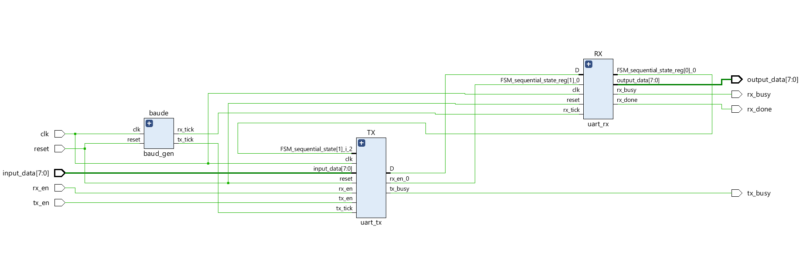
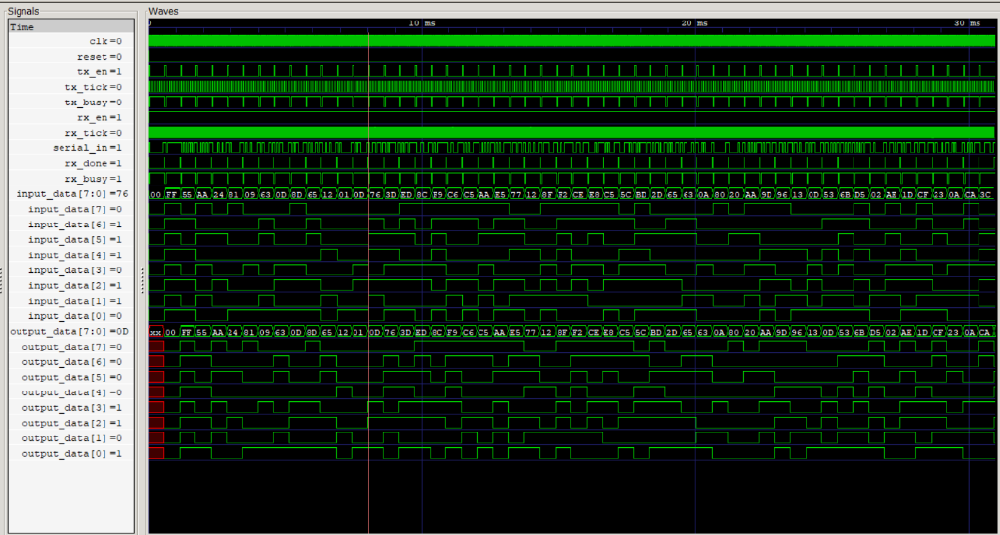

# UART TX/RX with Loopback Top
### SystemVerilog &nbsp;|&nbsp; Xilinx Artix-7 &nbsp;|&nbsp; Vivado 2018.3

An educational UART TX/RX design implemented in SystemVerilog, with an internal loopback top, synthesized and evaluated using Vivado 2018.3 for a Xilinx Artix-7 target. The reported timing results apply to the configured out-of-context analysis and do not establish complete board-level timing closure.

### Vivado RTL Schematic



*Vivado-generated RTL schematic: `baud_gen` produces single-cycle enable ticks (`tx_tick`, `rx_tick`) on the primary clock. `uart_tx` serializes parallel input data, and `uart_rx` deserializes it back to parallel output with 16× oversampling.*

---

## Features

- **Independent TX/RX FSMs**: Independent transmitter (`uart_tx`) and receiver (`uart_rx`) operating concurrently.
- **Single-Clock-Domain Architecture**: All sequential logic runs synchronously on `clk`; no clock-domain crossings (CDC) or divided clocks.
- **Configurable Timing**: Parameterized system frequency (`Sysyem_freq`) and baud rate (`baude_rt`).
- **16× Oversampling Receiver**: Center-point sampling (tick 7 of 16) with start-bit glitch validation.
- **4-state FSMs**: 4-state transmission and reception (`IDLE`, `START`, `DATA`, `STOP`) with internal data latching and status flags (`tx_busy`, `rx_busy`, `rx_done`).
- **Self-Checking Testbench**: Queue-based scoreboard verification covering corner cases and randomized payloads.

---

## Repository Structure

```
Comm_protocol/
│
├── baud_gen.sv          # Baud rate generator (single-cycle tick pulse generator)
├── uart_tx.sv           # UART transmitter (FSM + PISO shift register)
├── uart_rx.sv           # UART receiver (FSM + 16× oversampler + SIPO shift register)
├── uart_top.sv          # Top-level integration module
├── uart_tb.sv           # Self-checking testbench (corner + random stimulus, scoreboard)
│
├── synth.tcl            # Vivado non-project batch synthesis and implementation script
├── util_synth.rpt       # Vivado post-synthesis utilization report
├── util_impl.rpt        # Vivado hierarchical utilization report (state: Fully Placed)
├── timing.rpt           # Vivado static timing analysis report (state: Fully Placed)
├── check_timing.rpt     # Vivado timing constraint and clock check report
├── synth.v              # Gate-level netlist generated by Yosys (for gate-level regression)
│
├── vivado_schematic.png # Vivado RTL schematic capture
└── gtkwave_waveform.png # GTKWave simulation waveform capture
```

---

## Architecture

### Module Overview

1. **`baud_gen`**: Generates single-cycle enable pulses on the system clock. It provides `tx_tick` once per bit period and `rx_tick` at 16× the baud frequency.
   $$\text{TX Period} = \frac{f_{\text{clk}}}{\text{baud rate}}, \quad \text{RX Period} = \frac{f_{\text{clk}}}{16 \times \text{baud rate}}$$
2. **`uart_tx`**: Contains a 4-state FSM (`IDLE` $\rightarrow$ `START` $\rightarrow$ `DATA` $\rightarrow$ `STOP`), a 3-bit bit counter, and a Parallel-In Serial-Out (PISO) shift register. It latches `input_data` upon asserting `tx_en` and transmits LSB-first.
3. **`uart_rx`**: Contains a 4-state FSM, a 4-bit tick counter (0–15), and a Serial-In Parallel-Out (SIPO) shift register. It validates the start bit at mid-bit (tick 7) to filter line glitches, samples each of the 8 data bits at tick 7, and asserts `rx_done` when the byte is successfully assembled.
4. **`uart_top`**: Top-level wrapper tying `baud_gen`, `uart_tx`, and `uart_rx` together with internal loopback and status monitoring.

```
                  ┌────────────────────────────────────────┐
                  │                uart_top                │
                  │                                        │
                  │   ┌────────────┐   tx_tick             │
clk, reset ───────┼──►│  baud_gen  ├───┬──────┐            │
                  │   └────────────┘   │      │ rx_tick    │
                  │                    ▼      ▼            │
tx_en, data_in ───┼──────────────────►┌────────┐           │
                  │                   │uart_tx │           │
tx_busy ◄─────────┼───────────────────┤        │           │
                  │                   └───┬────┘           │
                  │            serial_in  │                │
                  │            (internal) └────────┐       │
                  │                                ▼       │
rx_en ────────────┼──────────────────────────────►┌────────┐──► data_out
                  │                               │uart_rx │──► rx_done
rx_busy ◄─────────┼───────────────────────────────┤        │
                  │                               └────────┘
                  └────────────────────────────────────────┘
```

---

## Vivado Implementation & Timing Results

Target Device: **Xilinx Artix-7 35T (`xc7a35tcpg236-1`)** &nbsp;|&nbsp; Tool: **Vivado 2018.3** (Out-of-Context mode)

> [!NOTE]
> **Implementation Stage:** Although `synth.tcl` calls `route_design` before generating reports, the resulting report headers (`util_impl.rpt`, `timing.rpt`) list the design state as *Fully Placed*. Without execution logs to establish the exact post-route completion state, these metrics are conservatively documented as reflecting the *Fully Placed* design stage.

### Resource Utilization

Data extracted from `util_synth.rpt` and `util_impl.rpt`:

| Hierarchy / Module | Component | Slice LUTs | Flip-Flops | BRAM | DSP |
|:---|:---|:---:|:---:|:---:|:---:|
| **uart_top (Post-Synthesis)** | Top-level | 71 | 73 | 0 | 0 |
| **uart_top (Implementation Report)** | Top-level | 71 | 73 | 0 | 0 |
| ├── `baude` | `baud_gen` | 41 | 34 | 0 | 0 |
| ├── `RX` | `uart_rx` (FSM, counter, SIPO) | 16 | 26 | 0 | 0 |
| └── `TX` | `uart_tx` (FSM, counter, PISO) | 14 | 13 | 0 | 0 |

*Zero latches inferred, zero RAM blocks, zero DSP blocks used.*

### Static Timing Analysis (100 MHz Target)

Timing results from `timing.rpt` with a 10.0 ns (100 MHz) clock constraint on `clk`:

| Timing Metric | Slow Corner (Setup) | Fast Corner (Hold) | Failing Endpoints |
|:---|:---:|:---:|:---:|
| **Worst Slack (WNS / WHS)** | **+6.340 ns** | **+0.157 ns** | 0 / 114 |
| **Total Slack (TNS / THS)** | 0.000 ns | 0.000 ns | 0 / 114 |
| **Worst Pulse Width Slack (WPWS)** | **+4.500 ns** | — | 0 / 73 |

> [!IMPORTANT]
> **Timing Caveat (Unconstrained I/O Ports):**
> As verified in [`check_timing.rpt`](check_timing.rpt), **11 input ports and 11 output ports lack I/O delay constraints** (`set_input_delay` / `set_output_delay`).
> The slack numbers above represent **internal register-to-register paths only** (114 timing endpoints). Because external pin and board delays are not defined in this out-of-context configuration, an accurate system-level maximum frequency ($F_{\text{max}}$) cannot be established from these reports alone.

---

## Verification & Simulation

### RTL Simulation (Icarus Verilog + Testbench)

The self-checking testbench (`uart_tb.sv`) implements an automated queue scoreboard:
- Transmits **4 corner-case bytes** (`0x00`, `0xFF`, `0x55`, `0xAA`).
- Transmits **50 random bytes** generated via `$urandom`.
- Verifies received data order and integrity on each `rx_done` pulse using an expected FIFO queue (`exp_q[$]`).
- Includes a simulation watchdog timeout and the testbench holds tx_en until tx_busy asserts.

```bash
# Compile and run simulation
iverilog -g2012 -s uart_tb -o sim.vvp baud_gen.sv uart_tx.sv uart_rx.sv uart_top.sv uart_tb.sv
vvp sim.vvp

# Waveform inspection
gtkwave dump.vcd
```

### Simulation Waveforms



*GTKWave capture demonstrating loopback operation over 54 consecutive transactions: `input_data` matches `output_data` across all corner and random values, with coordinated `tx_busy`, `rx_busy`, and `rx_done` handshakes.*

### Gate-Level Regression Testing

A gate-level functional regression test was conducted against a generic gate netlist (`synth.v`) synthesized with Yosys:

```bash
# Compile netlist with generic simulation cells and run regression
iverilog -g2012 -s uart_tb -o gate.vvp uart_tb.sv synth.v "$simcells"
vvp gate.vvp
VCD info: dumpfile dump.vcd opened for output.
PASS: 54 bytes checked
uart_tb.sv:74: $finish called at 30933560000 (1ps)
```

The regression passed for all 54 tested bytes. This provides simulation-based evidence of functional consistency for the tested cases; it is not a formal equivalence proof.

---

## Key Design Decisions

1. **Tick-Pulse vs. Clock Dividers:**
   - Generating single-cycle tick pulses preserves a single clock domain across all flip-flops.
   - Avoids clock skew, asynchronous clock-domain crossing (CDC) synchronizers, and generated-clock constraint complexity.
2. **Tick-Gated Counter Updates:**
   - The RX bit counter only resets or increments when `rx_tick` is asserted. Synchronous state transitions without tick qualification would prematurely clear counter states before the next sample window arrives.
3. **Mid-Bit Center Sampling & Glitch Filtering:**
   - Evaluating the start bit at tick 7 (center of the 16× window) designed to reject erroneous frame receptions.

---

## Limitations & Future Extensions

- **I/O Delay Constraints:** Requires board-level constraints (`set_input_delay` / `set_output_delay`) with package pin assignments for physical hardware implementation.
- **Input Metastability:** The asynchronous external serial input should be routed through a 2-flip-flop synchronizer chain before entering the RX FSM.
- **Buffering & Flow Control:** Currently single-byte buffered; adding FIFO buffers (e.g., 16-deep TX/RX FIFOs) and RTS/CTS hardware flow control would improve integration with host CPUs.
- **Configurable Frame Format:** Frame configuration is currently fixed to 8 data bits, 1 stop bit, no parity (8N1).
- **Internal loopback:** uart_top connects the transmitter and receiver internally; the current top level does not expose external TX/RX serial pins.
- **Transmit-enable handshake:** `tx_en` is sampled on `tx_tick`, so a short pulse may be missed. The caller must hold it until `tx_busy` asserts.

---

## License

This project is available for educational and portfolio reference.
